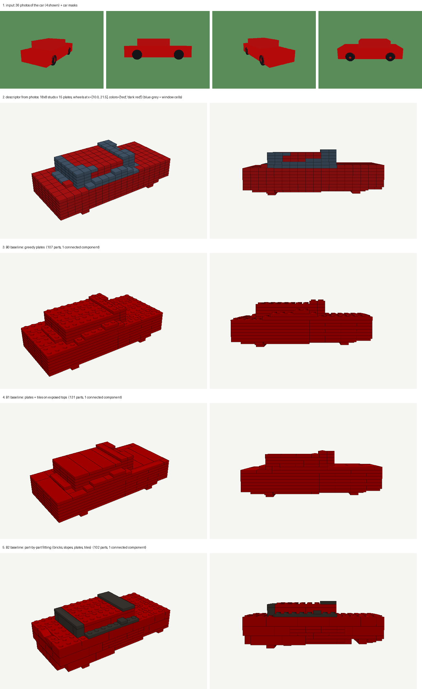

# car2brick：真车照片 → 官方风格乐高模型

本分支在 BrickNet 之上实现课程项目的完整流程。整体分两段，中间用一个"桥"连接：

```
            前半段（不需要乐高数据）                      后半段（只需要乐高数据）
真车照片 ─▶ 位姿 ─▶ 掩码 ─▶ 视觉外壳 ─▶ 车体坐标系 ─▶ 粗形状描述 ─▶ 条件生成 + 约束解码 ─▶ .ldr
                                                      ▲ 桥
                              乐高模型（BrickNet / 官方套装）也能算出同样格式的描述
```

- **桥** `car2brick/descriptor.py`：stud × stud × plate 分辨率的占据网格，加车轮位置和主色/副色。真车和乐高模型都通过同一个函数 `descriptor_from_points` 得到它。
- **后半段**的训练样本是"乐高模型自己的描述 → 它自己的搭建序列"，自监督构造，不需要任何真车配对数据。
- **ShapeNet** 用来做自训练，让模型适应真车形状的描述。

---

## 1. 目录

| 文件 | 作用 |
|---|---|
| `src/car2brick/units.py` | 单位（LDU）、车体坐标系、24 个轴对齐旋转 |
| `src/car2brick/descriptor.py` | **桥**：`CarDescriptor`、点云 → 描述、文本序列化/反序列化、训练扰动、车轮检测 |
| `src/car2brick/geometry.py` | 零件几何（BrickNet 碰撞体 / LDraw 零件库 / 连接点凸包兜底），用于体素化 |
| `src/car2brick/lego.py` | 乐高侧：LDraw / BrickNet 图 → 车体坐标系 → 描述；车辆筛选特征 |
| `src/car2brick/ldraw_io.py` | 展开 `.mpd` 子模型，保留说明书 `STEP` 序号 |
| `src/car2brick/canonical.py` | 前半段：点云/网格摆正（PCA + 对称面搜索 + 缩放到 8 宽），网格 → 描述 |
| `src/car2brick/recon/` | 前半段：COLMAP、SAM2 掩码、视觉外壳、颜色/语义投影、`photos_to_descriptor` |
| `src/car2brick/colors.py` | 乐高色板与 CIELAB 量化 |
| `src/car2brick/sequence.py` | 训练/生成文本格式：描述前缀 + BrickNet path text + **位置锚点**；底盘优先的搭建顺序 |
| `src/car2brick/decode.py` | **约束解码**：模型提议零件 → 解析、组合位姿 → 体积约束 + 碰撞检测 → 接受或重采样 |
| `src/car2brick/dataset.py` | 从 BrickNet 图 / LDraw 文件夹生成 SFT 数据（与 BrickNet 训练脚本格式一致） |
| `src/car2brick/selftrain.py` | ShapeNet 自训练：生成 → 筛选 → 写回训练格式 |
| `src/car2brick/baseline.py` | 非学习基线：B0 贪心铺板，B1 再加顶面 tile |
| `src/car2brick/fit.py` | 非学习基线 B2：逐零件拟合（砖、斜面、板、tile），规则见 5.7 |
| `src/car2brick/evaluate.py` | IoU、连通性、碰撞；网格位姿 → LDraw；按目标颜色重新上色 |
| `scripts/train_car2brick.py` | 复用 BrickNet 的 `scripts/train.py sft`，只覆盖序列长度、步数等配置 |
| `scripts/car2brick_smoke.py` | 无需下载的端到端冒烟测试（小模型记住一辆车再生成出来） |
| `scripts/car2brick_demo.py` | 生成示例图：合成照片 → 描述 → B0/B1 基线（输出在 `docs/car2brick/`） |
| `src/car2brick/render.py` | 无额外依赖的预览渲染器（numpy z-buffer + PIL） |
| `tests/car2brick/` | 单元测试与合成数据 |

对 BrickNet 原有代码只改了一处：`bricknet/score.py` 改为延迟导入 `collision`，这样没装 pybullet 也能解析序列。

---

## 2. 安装

pybullet 目前没有 Python 3.13 的预编译包，建议用 Python 3.12：

```bash
uv venv -p 3.12 .venv && . .venv/bin/activate
uv pip install -e ".[car2brick]"           # numpy scipy pybullet trimesh pillow
uv pip install -e ".[train]"               # 训练/生成：torch transformers peft accelerate liger-kernel
python -m bricknet fetch-meshes            # BrickNet 碰撞体（约 1 GB），用于碰撞检测和更精确的体素化
```

可选依赖：
- COLMAP 命令行（`photos2desc` 自动跑 SfM 时需要）
- SAM2（自动分割车身掩码）
- LDraw 零件库（设置 `LDRAW_DIR`，没有碰撞体时作为零件几何来源）

---

## 3. 前半段：照片 → 描述

### 3.1 拍摄
- 绕车一圈拍视频或照片，**视角越多越好**。合成测试中 24 个视角 IoU 约 0.6，36 个约 0.72，72 个约 0.74
- 可以的话补几张低机位的照片，让车底和车轮之间的空隙可见

### 3.2 运行
```bash
# 视频抽帧（可选）
python -c "from car2brick.recon.colmap import extract_frames; extract_frames('car.mp4', 'frames', fps=2)"

# 自动跑 COLMAP，掩码来自文件夹（同名 png）或 SAM2
python -m car2brick photos2desc --images frames --workspace ws --masks masks --out car.npz
python -m car2brick photos2desc --images frames --workspace ws \
    --sam2-ckpt sam2_hiera_large.pt --sam2-cfg sam2_hiera_l.yaml --out car.npz

# 已有 COLMAP 文本模型（或 VGGT / MASt3R 导出的同格式模型）
python -m car2brick photos2desc --colmap-model ws/dense/sparse_txt --image-dir ws/dense/images \
    --masks masks --labels window=win_masks light=light_masks --out car.npz

# 用其他方法得到的网格（2DGS / TRELLIS / Hunyuan3D / ShapeNet）
python -m car2brick mesh2desc car.obj --up auto --colors red black --out car.npz
```

### 3.3 实现要点（以及原因）
- **视觉外壳**比 MVS 稠密重建更适合车：车漆反光、纹理少，但掩码轮廓可靠。`max_misses` 允许少数视角的掩码或位姿出错
- **两次雕刻**：第一次在整个场景范围内粗雕，第二次在第一次结果的包围盒里细雕，再做摆正
- **"往上"的方向**用相机平均位置作为提示（拍摄者站着拍，相机通常高于车）
- **宽度在半高处测量，并裁掉底部外扩**：平视拍摄雕不掉车身下缘两侧的空间，外壳会在底部向外张开
- **车轮用轮胎颜色检测**：平视看不到车底，基于占据网格的检测会失效，所以改为找车身两侧、低处、暗且不饱和的点，取两个峰值
- **前后方向无法从形状判断**，但不影响生成：BrickNet 里的车本来就是两个朝向都有。需要固定朝向时传 `front_hint`

---

## 4. 桥：描述的文本格式

```
<official>
car 20x8x12           # 长 x 宽（stud） x 高（plate）
wheels 9.5 22.5       # 车轮中心所在的网格 x 坐标
colors red, black
6 6/1 6/1 6/1 6/1     # 行 = x；每一列从中线往外（半宽，车是对称的）："顶/底" 的 plate 层号
...
13 11/1 11w/1 11/1 6/1    # 'w' = 顶面是车窗，'l' = 车灯
```

这段文本就是生成模型的条件前缀。训练时用 `perturb()` 对它加噪：模糊 + 阈值抖动、膨胀或腐蚀、列高 ±1、车轮位置抖动。目的是让从乐高模型算出的描述看起来像从真车算出的。

---

## 5. 后半段：描述 → 乐高

### 5.1 序列格式（`sequence.py`）
```
<描述文本>
a plate 2x8 | red
@root 178 120 7 r17        <- 根零件：网格坐标系下的原点（LDU）+ 轴对齐旋转编号
b plate 2x10 | red
a stud stud m hole f 270   <- BrickNet 原有的连接边，未改动
@ 10 3 1                   <- 新零件所在的格子（x stud, y stud, z plate）
```
- **位置锚点**让模型知道"现在搭到哪了"，从而能和描述对应起来。生成时锚点**由解码器计算后写入**，不让模型采样，所以总是正确的
- **搭建顺序**：在连接图上按 (说明书步骤, 层高, x, y) 的优先级遍历，自然得到"底盘优先、从下往上"的顺序；对 `.mpd` 官方模型会使用 `STEP`

### 5.2 构建数据
```bash
# 解压 BrickNet 数据（需先通过表单申请）
xz -dk sft.npz.xz pt.npz.xz

python -m car2brick build-data \
    --graphs sft.npz pt.npz --captions captions_sft.jsonl.xz "" \
    --ldr-dir official_speed_champions/ --official official_ids.txt \
    --orders 2 --augs 3 --out data/
```
- 车辆筛选：轮子类零件 ≥ 3，宽 5–11 stud，长 ≥ 1.5 倍宽，零件数 ≤ 600
- 风格标签：`official` = 在 `--official` 列表里，或 BrickNet 描述里提到 Speed Champions；`moc8` = 其他 7–9 宽的车；`other` = 其余
- 输出 `paths_*.jsonl` / `captions_*.jsonl`，格式和 BrickNet 的 SFT 数据**完全一致**；另有 `descriptors/*.npz`（评测用）和 `index.jsonl`（统计）

**第一步建议先跑 `--limit 0` 看 `index.jsonl`**：有多少辆车、多少是 8 宽、多少带 STEP 信息。

### 5.3 训练
```bash
python scripts/train_car2brick.py \
    --model Qwen/Qwen3-0.6B --pt_adapter kulits/BrickNet-0.6B-PT \
    --paths data/paths_train.jsonl --captions data/captions_train.jsonl \
    --val_paths data/paths_val.jsonl --val_captions data/captions_val.jsonl \
    --output runs/c2b --max_len 12288 --iters 6000 --batch 4
```
车的序列比 BrickNet 的 SFT 样本长得多（几百个零件加锚点行），所以 `max_len` 调大了。显存不够时减小 `--batch` 或 `--max_len`（过长的样本会被截断）。

### 5.4 生成
```bash
python -m car2brick generate car.npz --model Qwen/Qwen3-0.6B \
    --lora kulits/BrickNet-0.6B-PT --lora runs/c2b/adapter \
    --samples 8 --recolor --out out/
```
每个样本输出 `.ldr`（可用 LDView / BrickLink Studio 打开）和锚点序列，`summary.json` 汇总 IoU、连通分量和碰撞情况。

### 5.5 ShapeNet 自训练
```bash
python -m car2brick selftrain --meshes ShapeNetCore.v2/02958343 --up y \
    --model Qwen/Qwen3-0.6B --lora kulits/BrickNet-0.6B-PT --lora runs/c2b/adapter \
    --samples 4 --min-iou 0.45 --out st1/
cat data/paths_train.jsonl st1/paths_selftrain.jsonl > mix/paths.jsonl
cat data/captions_train.jsonl st1/captions_selftrain.jsonl > mix/captions.jsonl
# 然后用 mix/ 再训一轮
```

### 5.6 基线与评测
```bash
python -m car2brick baseline car.npz --method b0 --out b0.ldr   # B0：贪心铺板
python -m car2brick baseline car.npz --method b1 --out b1.ldr   # B1：加顶面 tile
python -m car2brick baseline car.npz --method b2 --out b2.ldr   # B2：逐零件拟合
python -m car2brick eval b2.ldr car.npz
```

### 5.7 B2 逐零件拟合的规则（`fit.py`）
从最底层往上，一次放一个零件。每一步从零件库（板、砖、45°/33°/18° 带凸点斜面、tile）里，选出位置和朝向都最贴合目标形状的那个。

**硬约束**（违反就不放）：
1. 零件落在 stud 网格上，凸点朝上，只做 90° 旋转（这个基线不做侧装）
2. 不能和已放的零件重叠（以半 stud × 半 stud × 半 plate 的子格为单位判断）
3. 必须有支撑：至少一个底孔压在下方零件的空闲凸点上；只有脚下在目标形状里为空时（比如两个车轮之间的底板），才允许作为"底座"件直接放
4. 左右对称：每放一块，同时放它的镜像
5. 统一层次：砖和斜面这种 3 层板高的零件，只能从车身底面所在层起步，每 3 层一档；其他高度用板来补。否则相邻区域会错开一层板，上面的零件永远没法把它们连起来

**打分**（对零件会占据的每个子格求和）：
- 在目标里：+1
- 紧挨目标外面一圈：−0.5（容忍目标本身的粗糙）
- 明显在目标外：−3（溢出比少一格更糟）
- 每额外连通一个原本分开的块：+0.5 × 零件体积（鼓励错缝咬合，保证整辆车是一体的）
- 得分至少要达到零件体积的 60%，零件才有资格被放

**顺序**：逐层从下往上；同一层里按得分从高到低放（大零件自然得分更高，所以零件总数少）。

**收尾**：
- 顶面完全露出的板，换成同尺寸的 tile
- 覆盖车窗格子的零件用透明黑色，其余用主色

**斜面几何**：带凸点的斜面在没有零件模型时用解析楔形（凸点那排是高端，低端留 4 LDU 的边）。芝士斜面需要真实几何（BrickNet 碰撞体或 LDraw 库），装了才会启用。曲面斜面底部不规整，这一版没有用。

**效果**（`docs/car2brick/6_sloped_b1_vs_b2.png`）：在有斜车头的样车上，B2 用 18° 斜面做出了斜引擎盖，B1 那里是板的台阶；零件数 76，B1 是 84。风挡和后窗仍是台阶，因为目前只有 1–2 宽的斜面，而且斜面必须从统一的层次起步。

---

## 6. 示例图

`python scripts/car2brick_demo.py` 用测试里的合成样车生成 `docs/car2brick/overview.png`：36 张合成照片 → 前半段得到的描述（蓝灰色为车窗格子）→ B0 → B1 → B2。另有 `6_sloped_b1_vs_b2.png`，在带斜面的样车上对比 B1 和 B2。这些图只展示前半段和非学习基线，学习模型需要在 BrickNet 数据上训练后才有官方风格的效果。



## 6.1 已验证内容（在本仓库的云端环境中）

没有 GPU，也无法访问 HuggingFace、LDraw 和 BrickNet 的数据下载地址，所以用合成数据和包内自带的连接点标注做验证：

- `pytest tests/car2brick`：25 个测试全部通过
  - **桥的往返**：合成车 → 描述 → B1 基线 `.ldr`（1 个连通分量）→ 再算描述，IoU > 0.95；文本序列化往返 IoU = 1.0
  - **前半段**：渲染 36 个视角的掩码和图片，写成 COLMAP 文本模型，跑 `photos_to_descriptor`：宽 8 stud，长和高与真值相差 1–2 格，主色红，车轮位置误差 < 10%，IoU > 0.6
  - **序列**：锚点序列能被 BrickNet 解析，重建位姿误差 < 1e-6
  - **约束解码**：按真值提议时完全复现原模型（IoU 1.0），场外的根零件和无法解析的提议会被拒绝
  - **数据构建**：`.mpd` 子模型展开、STEP 序号、风格标签、标题与样本的对应关系符合 BrickNet `sft_pairs` 的约定
  - **HFProposer**：用本地构建的小型 Qwen3 结构模型验证采样、按行截断和对数似然计算
- `scripts/car2brick_smoke.py`：小模型在 CPU 上记住一辆车的序列，再用完整的生成循环生成出来

**没有验证的**：真实照片、真实 COLMAP / SAM2 运行、BrickNet 数据集和预训练权重、GPU 训练、碰撞体文件（本环境下碰撞检查自动跳过）。

## 7. 已知限制与后续可做

- 视觉外壳在视角少时偏胖；视角多一些，或改用 `mesh2desc` 配合更好的表面重建
- 零件几何在没有碰撞体或 LDraw 库时，用连接点凸包近似，对曲面件、车轮比较粗
- `HFProposer` 每一步都重新编码前缀，没有复用 KV 缓存，长序列生成较慢（可以优化）
- B2 还没有曲面斜面、侧装（SNOT）、车轮和底盘模板；风挡这种 5 层板高的斜面目前仍是台阶
